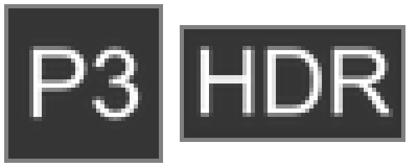
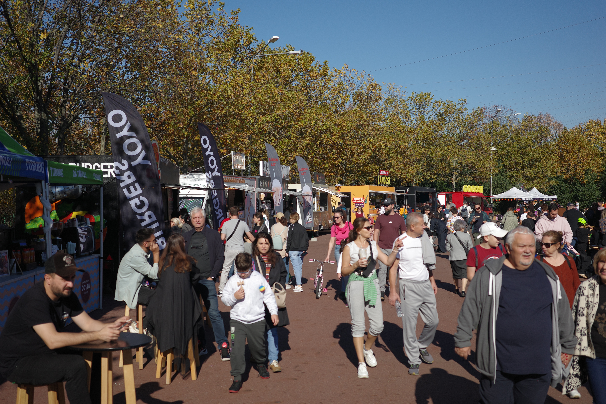
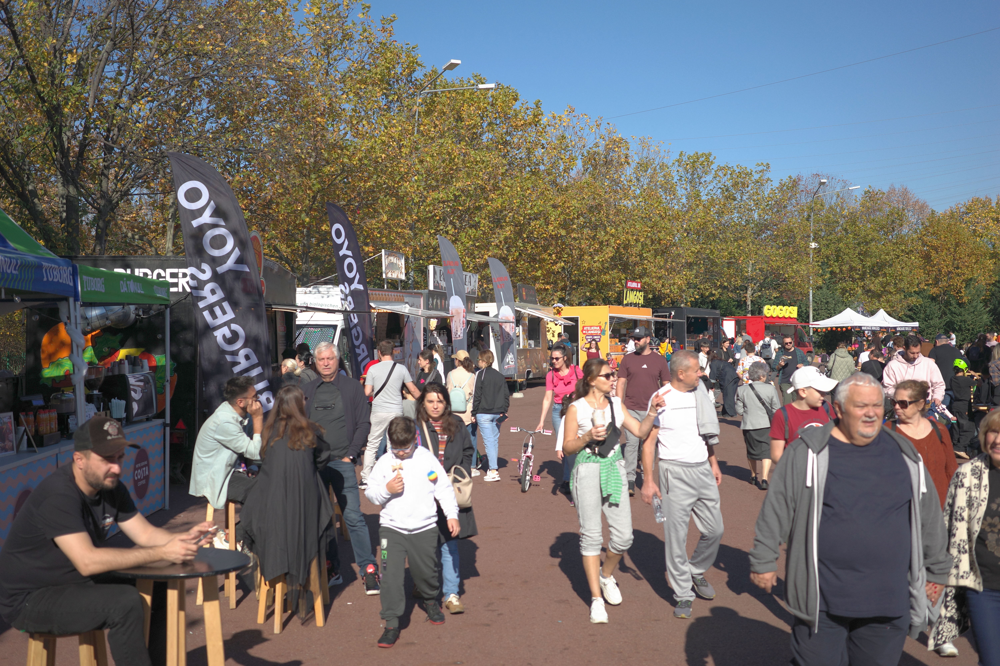
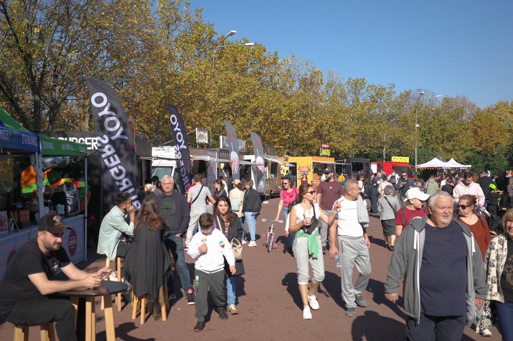
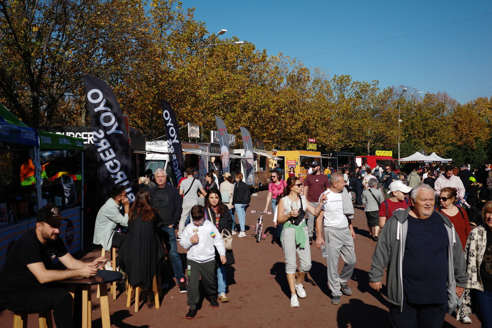
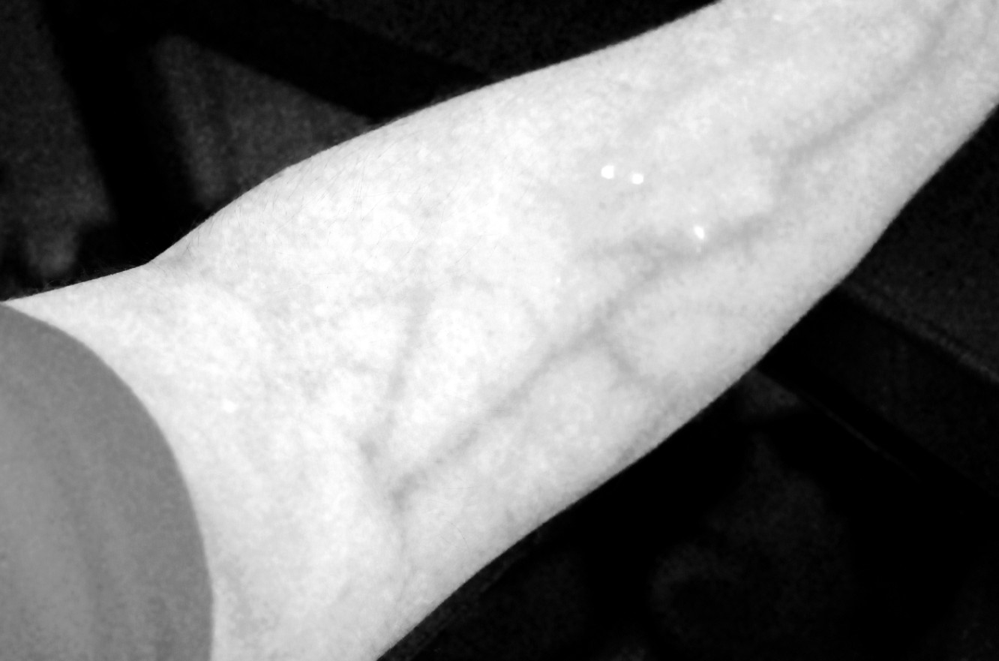

# Ricoh GR IIIx HDR

An offline patcher for **Ricoh GR IIIx firmware 1.60**. It reproduces the current experimental custom firmware from your original firmware file.

## Features

- **RAW+JPG HDR** with a full-resolution gain map, in sRGB or Display P3.
- **Display P3** color conversion and embedded ICC profile.
- **RAW Development** exports in P3 or HDR Display P3, using the P3 and HDR icons.
- **Multi RAW Development** applies one recipe to all camera RAWs on the card, with a progress bar, X/Y counter and resumable journal.
- **Natural / Natural+ / Natural++** calibrated profiles, with progressively deeper shadows.
- **Provia / Provia+ / Provia++** profiles fitted to a photographed Fujifilm XE5 Provia reference.
- **Smooth profile gradients** for all six Natural and Provia profiles, with softened tone-curve slope changes and preserved color matrices and black/white endpoints.
- **IR / Green / UV** RGB contrast effects. These do not capture physical infrared or ultraviolet light.
- Custom **P3/HDR and profile icons**, with the original camera looks retained.

HDR is generated from the processed image; it does not recover clipped RAW highlights. RAW remains on its native path. HDR gain-map compression adapts to detailed scenes to stay within the fixed memory budget. Full-resolution HDR can take longer to save; use single shots and wait for processing to finish. These are experimental profiles and firmware.

Profile icons: Natural `Nat`, Natural+ `Nat+`, Natural++ `Na++`; Provia `Prov`, Provia+ `Pro+`, Provia++ `Pr++`; IR `IR`, Green `Grn`, UV `UV`. Shared native mappings cover the quick menu, main Image Control menu, selected-profile summary, live view and playback details.


Color space and format icons:



## Camera usage notes

- After switching the camera on, wait a few seconds for the custom icons to update.
- **RAW+JPG HDR** is available in both the main File Format menu and the ADJ File Format control.
- **File Format** and **Color Space** selections are stored with the native camera settings. After installing this update, select your preferred options once and switch the camera off normally to save them.

In playback, open **RAW Development > Color Space** and choose **P3** for a Display P3 JPEG or **HDR** for a Display P3 JPEG with a full-resolution gain map.

Open **Playback Settings > Multi RAW Development**, immediately below RAW Development. It opens the newest RAW with the usual development controls. Set the look and output color space, then confirm the final save to process the card one RAW at a time. Each RAW retains its own as-shot white balance, including temperature and tint; the reference image does not impose its WB on the batch. Choose **HDR** under Color Space for HDR Display P3 JPEGs.

The last recipe and completed RAW/JPEG pairs are saved on the card. Run the same command again after an interruption to process the remaining files. A missing or replaced developed JPEG is generated again; changing the recipe creates a new batch. RAW files are preserved. Keep `RICOH/MRDEV` and `MRRECIPE.A`/`MRRECIPE.B` on the card to retain progress and the last recipe. `MRQUEUE.BIN` is rebuilt when opening the command; `MRSTATE.BIN` contains the latest processing diagnostic.

## Samples

Click an image to open the sample.

| Standard | Standard HDR (SDR preview) |
| --- | --- |
| [](samples/original1.jpg) | [](samples/std-hdr.jpg) |

| Natural | Provia |
| --- | --- |
| [](samples/natural.jpg) | [](samples/provia.jpg) |
| **Natural+** | **Provia+** |
| [](samples/natural-plus.jpg) | [](samples/provia-plus.jpg) |
| **Natural++** | **Provia++** |
| [](samples/natural-plus-plus.jpg) | [](samples/provia-plus-plus.jpg) |

### IR

[](samples/ir.jpg)

## Requirements

- **Python 3.8+**, available on PATH. No extra Python packages, compiler, or network access required.
- The **original Ricoh GR IIIx 1.60 firmware `.bin`**. Other models, firmware versions, and already-patched files are rejected.
- Windows uses PowerShell for the `.bat` launcher. Linux/macOS use `sh`.

Keep the scripts and the `native-cfw` folder together. The original firmware is not included or downloaded.

## Run

From this directory, choose one launcher:

**Windows:**

```powershell
.\patch-cfw.bat "C:\Downloads\fwdc243b.bin"
# Or:
.\patch-cfw.ps1 "C:\Downloads\fwdc243b.bin"
```

If PowerShell blocks local scripts:

```powershell
powershell -NoProfile -ExecutionPolicy Bypass -File .\patch-cfw.ps1 "C:\Downloads\fwdc243b.bin"
```

**Linux / macOS / WSL / Git Bash:**

```sh
sh ./patch-cfw.sh /path/to/original/fwdc243b.bin
```

By default, output is **`custom-firmware/fwdc243b.bin` beside the input file**. To choose another output file:

```powershell
.\patch-cfw.bat "C:\Downloads\fwdc243b.bin" -o "C:\Output\fwdc243b.bin"
```

```sh
sh ./patch-cfw.sh /path/to/original.bin -o /path/to/output/fwdc243b.bin
```

Every launcher accepts `--info` for version details and `-h` for help. Set `PYTHON` to a Python executable path if needed.

## Output and verification

All launchers apply the same version-specific binary delta and produce identical firmware. The input is preserved, existing output files are refused, and the complete input/output SHA-256 hashes are checked. Nothing is automatically flashed or copied to an SD card.

- Stock GR IIIx 1.60 SHA-256: `708e79f3b7b96a7e1581b4acf4c412233050a1832718ef7f06c8397db1b431c7`
- Current CFW SHA-256: `ca3b63c8929abc76ccf72398bca8bc5e09905a59a1d3b8708b3db86f26a4e258`
- Build: `native-cfw-smooth-profiles-1`

The delta is fixed to this build. It does not compile or update the firmware features when run. `native-cfw/make_patch.py` and `native-cfw/test_patcher.py` are developer utilities for generating and testing a pinned delta; applying it only needs the launchers, `patch.py`, and the patch package. See `native-cfw/THIRD_PARTY.txt` for attribution.
